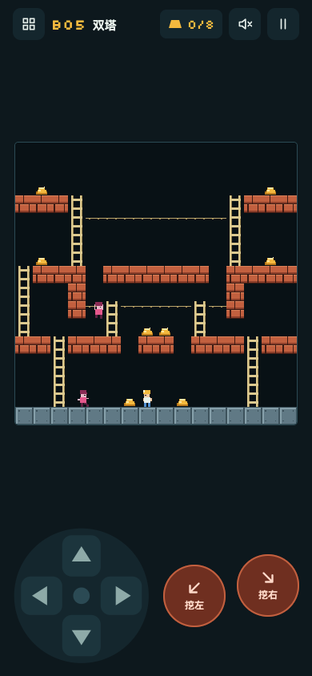

# 掘金夜班（Night Shift Miner）

[English](README.md) | 简体中文

一个在手机上玩的挖洞爬梯游戏，玩法致敬 1983 年的 Lode Runner。只有一个 HTML 文件，没有依赖，不用构建。打开一次之后断网也能玩，适合在飞机上打发时间。



## 怎么玩

用任意浏览器打开 `index.html`。手机上最省事的办法是开 GitHub Pages（Settings → Pages → 从 `main` 部署），然后「添加到主屏幕」。

| 动作 | 触屏 | 键盘 |
|---|---|---|
| 移动 / 爬梯 | 方向盘 | 方向键或 WASD |
| 跳两格 | 跳 | 空格 |
| 向左下 / 右下挖 | 挖左 / 挖右 | Z / X（或 Q / E） |
| 时缓开关（0.1 倍） | 时缓 | Shift |
| 暂停 | 暂停按钮 | P 或 Esc |
| 重来本层 | 暂停菜单 | R |

## 规则

- 收齐所有金块，出口梯从顶上放下来，爬到最顶一行过关。
- 只能挖斜下方的砖。灰色石头挖不动。
- 可以跳：按住方向起跳，平跳跨过一格宽的沟，或者斜上跳上高一格的平台。守卫不会跳。两次跳之间有短暂冷却。
- 时缓让整个矿井慢下来——你、守卫、洞的回填倒计时都变成 0.1 倍。再按一次恢复原速。
- 洞 8.5 秒后回填。回填时还在洞里的都会被埋，包括你自己。
- 守卫看不见洞。掉进洞的守卫会卡 3.6 秒，这时可以踩着它的头走过去。
- 守卫会拿走金块。把它困进洞里，金块会掉在洞口。
- 一共 12 层（B01 到 B12），一开始全部开放。每层的最好成绩存在浏览器里。

## 调用链路

```
requestAnimationFrame
  └─ frame(dt)
       ├─ update(dt × 时缓倍率)          仅当 state === 'play' 且没有菜单打开
       │    ├─ 洞：倒计时 → 回填 → 埋掉洞里的实体
       │    ├─ updatePlayer             playerChoose → startMove → advance → playerArrive
       │    │                           （重力、输入、挖洞、跳跃、捡金、出口判定）
       │    ├─ updateGuard × n          guardAI（BFS 追玩家，洞在它眼里是实心砖）
       │    │                           → guardChoose → advance → guardArrive（被困、拿金）
       │    └─ 碰撞                     守卫离玩家不到 0.6 格 → 死亡
       └─ draw()                        地形 → 洞 → 金块 → 守卫 → 玩家
```

移动是「按格移动 + 插值」：实体的 `x, y` 是它正要去的格子，`fx, fy` 是它离开的格子，`t` 是两者之间的进度。所有规则都按整格判定，所以求解器和游戏的结论一致。

## 关卡格式

关卡是 16×16 的字符串，写在 `index.html` 脚本的开头：

| 字符 | 含义 |
|---|---|
| `#` | 砖（能挖） |
| `@` | 石头 |
| `H` | 梯子 |
| `-` | 绳子 |
| `$` | 金块 |
| `S` | 出口梯，收齐金块后才出现 |
| `P` | 玩家出生点 |
| `E` | 守卫出生点 |
| `.` | 空 |

## 校验

```bash
node tools/solver.js index.html
```

求解器对每一层做两次 BFS（位置 × 已收金块）：一次不许跳、一次会跳，某一层无法通关就报错退出。它不算守卫，挖洞按保守模型算（一次只用一个洞），所以通过代表这一层不靠多洞技巧也能通关。如果跳跃把关卡最短路砍到不跳的 55% 以下，会打 WARN 提醒人工复核这层有没有被跳坏。它不证明这一层在守卫追击下是公平的。

`tools/e2e.js` 是十二步的浏览器冒烟测试（走路、爬梯、挖洞、掉落、捡金、跳跃、时缓、暂停、洞回填）。在 B01 层把它贴进控制台，或者用无头浏览器跑。

## 来历

用 Claude Code 在一次会话里做出来的。起因是看到 Boris Cherny 在飞机上让 Claude 给他做了一个手机游戏：https://x.com/bcherny/status/2108004023249088528

这是一个原创游戏，关卡、美术和代码都是自己的。Lode Runner 是其权利人的商标，本项目与其无关。

## License

MIT
